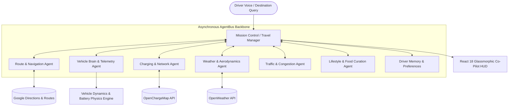

<p align="center">
  <h1 align="center">🚗 Electric Vehicle Brain</h1>
  <p align="center">
    <strong>Autonomous Multi-Agent AI Co-Pilot & Intelligent Long-Distance Trip Planning Engine for Electric Vehicles</strong>
  </p>
</p>

<p align="center">
  <a href="#overview">Overview</a> •
  <a href="#core-features">Features</a> •
  <a href="#multi-agent-orchestration">Multi-Agent System</a> •
  <a href="#ev-dynamics--physics">Battery Physics</a> •
  <a href="#tech-stack">Tech Stack</a> •
  <a href="#getting-started">Getting Started</a> •
  <a href="#telemetry-protocols">Telemetry</a> •
  <a href="#license">License</a>
</p>

<p align="center">
  
  
  
  
  
  
  
</p>

---

## 📖 Overview

**Electric Vehicle Brain** is an intelligent, multi-agent autonomous co-pilot and real-time navigation assistant purpose-built for electric vehicle road trips. Traditional navigation tools treat EVs like internal combustion engines with battery overlays; EV Brain treats range prediction as a complex physical and environmental optimization problem.

Orchestrated through an asynchronous **`AgentBus`** and stateful **LangGraph** workflows, EV Brain synthesizes live vehicle telemetry (State of Charge, battery temperature, kWh/km consumption curves), elevation grades, ambient weather headwinds, dynamic traffic conditions, and charging network reliability (OpenChargeMap) into seamless, anxiety-free long-distance journeys.

---

## ✨ Core Features

- **🧠 Multi-Agent Autonomy (AgentBus)**: Specialized autonomous agents communicate asynchronously across a centralized event bus to resolve complex journey constraints collaboratively.
- **🔋 Physical Battery Dynamics & Range Estimation**:
  - Incorporates kinetic aerodynamics, vehicle payload, temperature degradation, and topographic elevation profiles (`vehicle_dynamics.py`).
  - Accurately models non-linear DC fast charging curves (10% to 80% charging tapers).
- **⚡ Intelligent Charging Network Routing**:
  - Direct integration with **OpenChargeMap** API.
  - Automatically matches vehicle connector types (CCS2, CHAdeMO, Type 2, Tesla Supercharger) and power ratings (50kW – 350kW).
- **🍽️ Curated Lifestyle & Dining Sync**: Schedules culinary and rest breaks precisely during required 25-minute charging windows, tailored to driver dietary preferences.
- **🎙️ Conversational Jarvis In-Cabin Co-Pilot**: Voice-first ambient intelligence with speech recognition and natural text-to-speech feedback (Edge-TTS / ElevenLabs).
- **🌦️ Dynamic Weather & Headwind Compensation**: Pulls OpenWeather vectors along the driving corridor to predict HVAC load and aero drag penalties on battery range.
- **🖥️ Glassmorphic Live Dashboard**: Dark-mode heads-up display built with React 18, Vite, and Google Maps JavaScript API with real-time waypoint scrubbing.

---

## 🏛️ Multi-Agent Architecture



### Specialized Agents & Responsibilities

| Agent | Module | Core Functionality |
| :--- | :--- | :--- |
| **`MissionControl`** | `mission_control.py` | Central LLM orchestrator resolving tradeoffs between speed, battery safety margin, and comfort. |
| **`VehicleBrain`** | `vehicle_brain_agent.py` | Monitors live state of charge (SoC), consumption efficiency, and remaining usable capacity. |
| **`ChargingAgent`** | `charging_agent.py` | Selects optimal charging stops, minimizes detour distance, and models dwell time. |
| **`RouteAgent`** | `route_agent.py` | Decodes polylines, generates alternates, and provides turn-by-turn waypoints. |
| **`WeatherAgent`** | `weather_agent.py` | Ingests ambient temperature (HVAC impact) and wind velocity along highway segments. |
| **`FoodAgent`** | `food_agent.py` | Recommends top-rated dining spots directly walkable from charging stalls. |
| **`MemoryAgent`** | `memory_agent.py` | Stores driver preference vectors (preferred food, target arrival battery reserve %, preferred networks). |

---

## ⚡ Battery Physics & Energy Dynamics

EV Brain computes real-world range consumption via empirical energy formulas:

$$P_{	ext{total}} = P_{	ext{rolling}} + P_{	ext{aero}} + P_{	ext{gravity}} + P_{	ext{auxiliary}}$$

- **$P_{	ext{rolling}}$**: Rolling resistance accounting for road surface and tire friction coefficients.
- **$P_{	ext{aero}} = rac{1}{2} 
ho C_d A (v_{	ext{car}} + v_{	ext{headwind}})^2$**: Air density and frontal drag under ambient highway conditions.
- **$P_{	ext{gravity}} = m \cdot g \cdot \sin(	heta) \cdot v$**: Topographic elevation gradients with regenerative braking energy recuperation.
- **$P_{	ext{auxiliary}}$**: Cabin climate control draw based on differential between ambient temperature and interior target temperature.

---

## 💻 Tech Stack

| Layer | Technology | Details |
| :--- | :--- | :--- |
| **Backend Framework** | Python 3.10+, FastAPI, Uvicorn | Asynchronous telematics server |
| **Agentic Framework** | LangGraph, LangChain | Stateful multi-agent collaboration |
| **LLM Inference** | Google Gemini (Gemini Pro) | Real-time reasoning and natural language extraction |
| **Frontend UI** | React 18, Vite, Tailwind CSS | High-contrast glassmorphic cockpit HUD |
| **Maps & Geospatial** | Google Maps JS API (`@vis.gl/react-google-maps`) | Dynamic routing, polyline visualization & marker overlays |
| **Audio & Speech** | Edge-TTS, ElevenLabs, Web Speech API | Ambient hands-free voice co-pilot |
| **Data Providers** | OpenChargeMap, Google Maps Directions, OpenWeather | Real-world telemetry and charging infrastructure feeds |
| **Database** | SQLite, SQLAlchemy (Async), aiosqlite | Local telemetry and preference storage |

---

## 📂 Project Structure

```text
Car Co-pilot/
├── ev_travel_agent/
│   ├── agents/                   # Autonomous specialist agents
│   │   ├── mission_control.py    # Master coordinator
│   │   ├── vehicle_brain_agent.py# Telemetry & SoC monitoring
│   │   ├── charging_agent.py     # OpenChargeMap charging optimizer
│   │   ├── route_agent.py        # Polyline generation & routing
│   │   ├── weather_agent.py      # Wind & thermal impacts
│   │   ├── traffic_agent.py      # Congestion analysis
│   │   ├── food_agent.py         # Curated dining recommendations
│   │   └── memory_agent.py       # Driver preferences & history
│   ├── database/                 # Async SQLite database layer
│   ├── services/                 # External API wrappers (Maps, Weather, Charging)
│   ├── utils/
│   │   ├── agent_bus.py          # Asynchronous pub/sub message bus
│   │   ├── vehicle_dynamics.py   # Energy & battery physics simulation
│   │   └── config.py             # System configuration & secrets
│   ├── routers/                  # FastAPI endpoints
│   ├── frontend/                 # React 18 dashboard
│   │   ├── src/
│   │   │   ├── components/       # HUD widgets, battery meters, maps
│   │   │   └── App.tsx           # Co-pilot control console
│   │   └── package.json
│   ├── requirements.txt          # Python dependencies
│   └── main.py                   # Application entry point
└── README.md                     # Project documentation
```

---

## 🚀 Getting Started

### Prerequisites
- **Python**: 3.10 or higher
- **Node.js**: v18.0.0 or higher
- API Keys: Google Maps, Google Gemini (`GOOGLE_API_KEY`), OpenChargeMap, OpenWeather.

---

### 1. Clone & Environment Configuration

```bash
git clone https://github.com/itsgoksz/electric-vehicle-brain.git
cd electric-vehicle-brain
```

Create `.env` inside `ev_travel_agent/`:
```env
GOOGLE_MAPS_API_KEY=your_google_maps_key
VITE_GOOGLE_MAPS_API_KEY=your_google_maps_key
GOOGLE_API_KEY=your_gemini_api_key
OPEN_CHARGE_MAP_API_KEY=your_openchargemap_key
OPEN_WEATHER_API_KEY=your_openweather_key
ELEVENLABS_API_KEY=your_elevenlabs_key   # Optional (falls back to edge-tts)
```

---

### 2. Backend Setup

```bash
python3 -m venv venv
source venv/bin/activate

pip install -r requirements.txt
python -m ev_travel_agent.main
```
The FastAPI backend will start at **`http://localhost:8000`**.

---

### 3. Frontend Setup

```bash
cd ev_travel_agent/frontend
npm install
npm run dev
```
Open **`http://localhost:5173`** to access the live EV Brain cockpit HUD.

---

## 📄 License

Distributed under the **MIT License**.

<p align="center">
  Built for the electric mobility future by <a href="https://github.com/itsgoksz">itsgoksz</a>
</p>
