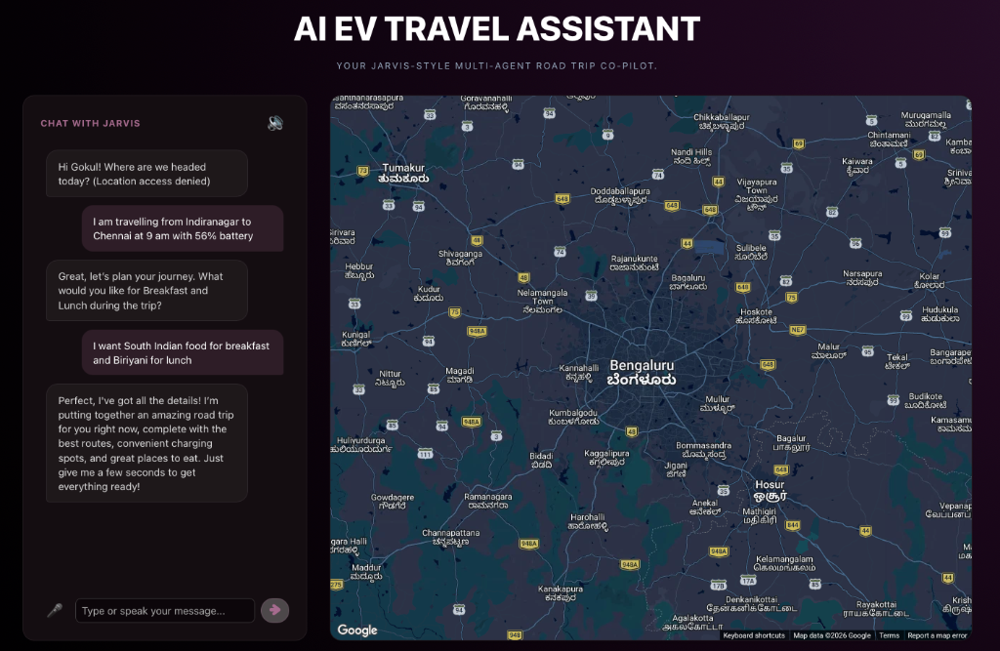
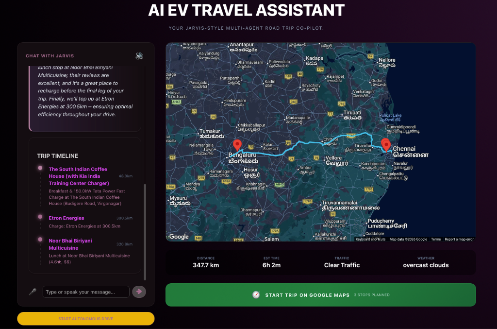
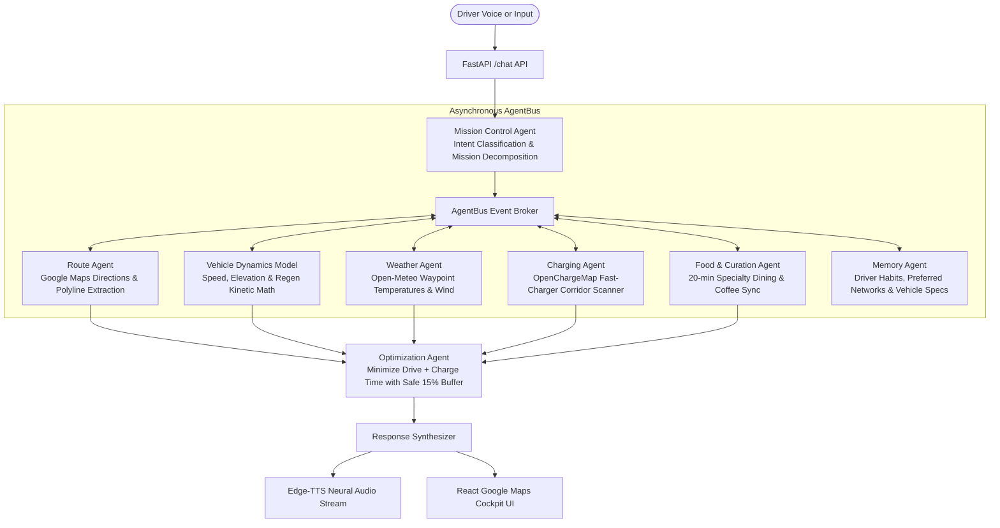

# Electric Vehicle Brain

> Autonomous multi-agent trip planning engine and in-cockpit voice co-pilot for Electric Vehicles. Models real-world aerodynamic drag, mountain elevation climbs, 10%→80% DC fast-charging tapers, and curated artisan dining stops over an asynchronous event bus.

<p align="center">
  
</p>

---

## The Hard Problem with EV Road Trips

Standard navigation apps treat electric cars like internal combustion engines with a battery icon on top: they draw the shortest highway line, divide distance by an arbitrary EPA rating, and tell you you will arrive with 12% battery.

Then reality strikes:
1. **The Western Ghats & Mountain Ascent Penalty:** Heading from Bangalore up to Coorg or the Nilgiris (+1,850m elevation climb) increases energy draw **by up to 3x**. EPA estimates crumble on real ascents.
2. **The 80% Fast-Charging Trap:** DC fast chargers (150kW+) pump peak power into battery packs between **10% and 80% State of Charge (SoC)**. After 80%, the battery management system throttles down to a trickle (15–25kW) to protect cell chemistry. Waiting around to charge to 100% wastes 45 extra minutes of your life.
3. **The Desolate Truck-Stop Misery:** Generic maps dump you at unshaded, broken single-gun chargers behind industrial toll gates with nowhere to sit, zero coffee, and dirty restrooms.
4. **Range Anxiety in the Driver's Seat:** Staring nervously at a dropping battery gauge while driving 110 km/h into a stiff headwind makes road trips exhausting instead of fun.

**Electric Vehicle Brain** solves this by treating long-distance EV travel as a physical, meteorological, and logistical optimization puzzle orchestrated by autonomous AI agents.

---

## Core Innovations

### 1. Aerodynamic & Elevation Physics Engine
Rather than assuming static km/kWh consumption, `VehicleDynamics` calculates dynamic consumption multipliers for every leg of the route:
- **Kinetic Drag:** Models exponential aerodynamic drag scaling at highway speeds (cruising at 120 km/h vs 85 km/h).
- **Topographic Grade:** Simulates heavy energy expenditure on uphill climbs (+1,800m Nilgiris pass) and calculates downhill **regenerative braking recuperation** (e.g. cresting a pass at 18% SoC and regenerating ~4.2 kWh on the descent into the valley).
- **Meteorology & Thermal Penalty:** Connects to Open-Meteo along route waypoints to factor in headwinds, ambient temperature, and cabin HVAC draw.

### 2. The 10% → 80% Peak Curve Optimization
EV Brain plans charging stops **strictly within your battery's peak acceptance window**. By pulling into a 150kW DC fast charger at 12–18% SoC and departing at 75–80%, you achieve the highest possible average charging speed—slashing total door-to-door trip duration.

### 3. Curated 20-Minute Lifestyle & Coffee Sync
Because your optimal DC charge stop takes only 20 to 25 minutes, EV Brain pairs every charging stop with verified dining:
- Automatically filters out bleak industrial substations and unshaded gravel lots.
- Matches stops with specialty coffee roasteries (Blue Tokai, artisan bakeries, Subbaiah Kaapi House) within a 2-minute walk of the charging bay.
- Aligns with driver dietary preferences (pure vegetarian, South Indian filter coffee, pet-friendly green spaces).

### 4. 100% Voice-Driven Conversational Co-Pilot with Live Transcripts
Built for eyes-on-the-road driving. The entire trip planning dialogue happens naturally through voice with your AI car co-pilot:
- **Hands-Free In-Cockpit Voice:** Drivers speak naturally to plan journeys, adjust schedules, and request real-time battery status without taking their hands off the wheel or eyes off the highway.
- **Synchronized Live Chat Transcripts:** Every voice utterance from both the driver and the AI co-pilot is transcribed and rendered in real time in the cockpit chatbox, providing clear visual telemetry of all decisions.
- **Dual-Modality (Voice & Typing):** While the system is optimized for complete voice control, drivers or passengers can also seamlessly type prompts and queries directly into the chat prompt at any time.

<p align="center">
  
</p>

### 5. Multi-Stop Charging & Dining Itinerary Timeline
Once your route is planned, EV Brain renders an interactive timeline detailing every waypoint, arrival distance, and charging station specification alongside curated dining:

<p align="center">
  
</p>

---

## Multi-Agent Architecture (AgentBus)

EV Brain coordinates specialized autonomous agents communicating through an asynchronous in-memory event bus:



---

## Tech Stack

| Layer | Technology | Description |
| :--- | :--- | :--- |
| **Backend API** | [FastAPI](https://fastapi.tiangolo.com/) + Uvicorn | High-throughput asynchronous Python server |
| **Agent Framework** | [LangChain](https://www.langchain.com/) & [LangGraph](https://langchain-ai.github.io/langgraph/) | Multi-agent coordination, tool calling & graph state |
| **LLM Inference** | Google Gemini & Ollama | Intent classification, query reasoning & natural dialogue |
| **Kinetic Dynamics** | Custom Python Engine | Elevation gradients, aerodynamic drag & regen models |
| **Navigation & Mapping**| Google Maps API (`googlemaps`) | Turn-by-turn routing, polyline geometry decoding |
| **EV Station Network** | OpenChargeMap API | Global charging station database, plug types (CCS2/Type 2) & power ratings |
| **Weather Telemetry** | Open-Meteo API | Free, real-time meteorological conditions along waypoints |
| **Voice & Speech** | `edge-tts` & `react-speech-recognition` | Low-latency neural voice synthesis & speech input |
| **Frontend Cockpit** | [React](https://react.dev/) + [Vite](https://vite.dev/) | Cockpit map with `@vis.gl/react-google-maps` |
| **Local Database** | SQLite + SQLAlchemy (`aiosqlite`) | Local trip history, driver preferences & battery profiles |

---

## Repository Structure

```text
Car Co-pilot/
├── assets/                       # Visual assets & UI captures
│   ├── preview.png               # Live cockpit route telemetry
│   ├── voice_chat_preview.png    # Hands-free voice dialogue & live chat transcripts
│   └── timeline_preview.png      # Multi-stop fast charging & dining timeline
├── ev_travel_agent/
│   ├── agents/                   # Specialized agent suite
│   │   ├── mission_control.py    # Master coordinator & query classifier
│   │   ├── route_agent.py        # Google Maps pathing & leg breakdown
│   │   ├── vehicle_brain_agent.py# Pack capacity & real-time SoC tracker
│   │   ├── charging_agent.py     # OpenChargeMap fast-charger scanner
│   │   ├── weather_agent.py      # Waypoint temperature & wind analysis
│   │   ├── food_agent.py         # Curated dining & coffee discovery
│   │   ├── optimization_agent.py # Total travel time & charging curve solver
│   │   └── memory_agent.py       # Driver preferences & trip history
│   ├── utils/
│   │   ├── agent_bus.py          # Asynchronous pub/sub event broker
│   │   ├── vehicle_dynamics.py   # Energy consumption physical model
│   │   └── route_utils.py        # Polyline decoding & geometric helpers
│   ├── services/
│   │   ├── maps_service.py       # Google Maps client wrapper
│   │   ├── charging_service.py   # Charger network query client
│   │   └── weather_service.py    # Open-Meteo weather client
│   ├── routers/
│   │   └── chat.py               # Conversational & SSE audio streaming endpoints
│   ├── frontend/                 # React + Vite cockpit application
│   │   ├── src/
│   │   │   ├── App.jsx           # Cockpit UI, polyline map & voice triggers
│   │   │   └── App.css           # Dark cockpit styling
│   │   ├── package.json
│   │   └── vite.config.js
│   ├── database/                 # SQLite models & async sessions
│   ├── main.py                   # FastAPI server entry point
│   └── requirements.txt
├── requirements.txt
└── README.md
```

---

## Getting Started

### 1. Prerequisites
- **Python 3.10+**
- **Node.js 18+**
- A **Google Maps API Key** (Directions & Places enabled)
- A **Google Gemini API Key** (or local Ollama instance)

### 2. Clone the Repository
```bash
git clone https://github.com/itsgoksz/electric-vehicle-brain.git
cd electric-vehicle-brain
```

### 3. Backend Setup
```bash
cd ev_travel_agent
python3 -m venv venv
source venv/bin/activate
pip install -r requirements.txt
```

Create a `.env` file inside `ev_travel_agent/`:
```env
GOOGLE_MAPS_API_KEY=your-google-maps-api-key
GEMINI_API_KEY=your-gemini-api-key
# Optional: OPENCHARGEMAP_API_KEY=your-openchargemap-api-key
```

Run the backend server:
```bash
uvicorn main:app --reload --port 8000
```

### 4. Frontend Cockpit Setup
In a new terminal window:
```bash
cd ev_travel_agent/frontend
npm install
```

Create a `.env` in `ev_travel_agent/frontend/`:
```env
VITE_GOOGLE_MAPS_API_KEY=your-google-maps-api-key
```

Start the Vite development server:
```bash
npm run dev
```
Open [http://localhost:5173](http://localhost:5173) to enter the cockpit, plan mountain road trips, and query the voice co-pilot.

---

<p align="center">
  Engineered for the open road by <a href="https://github.com/itsgoksz">itsgoksz</a>
</p>
