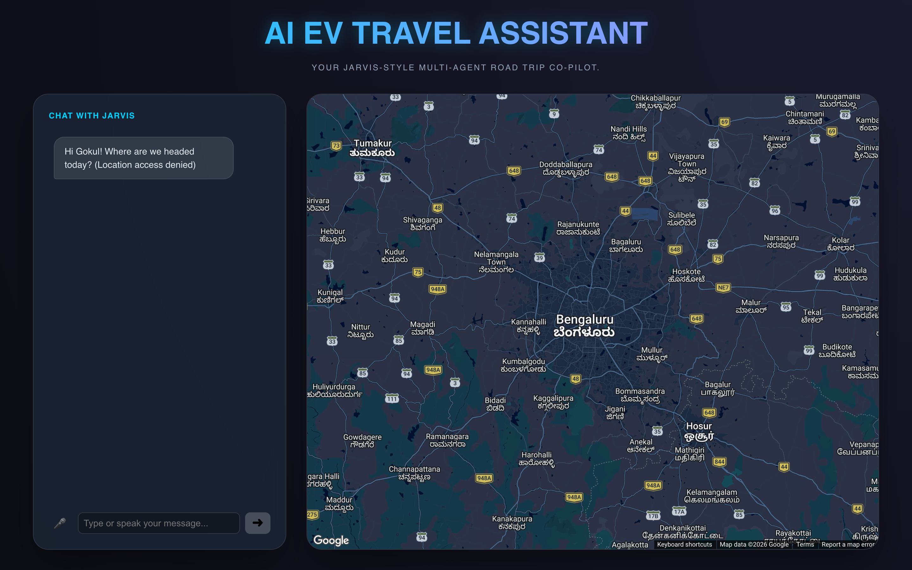
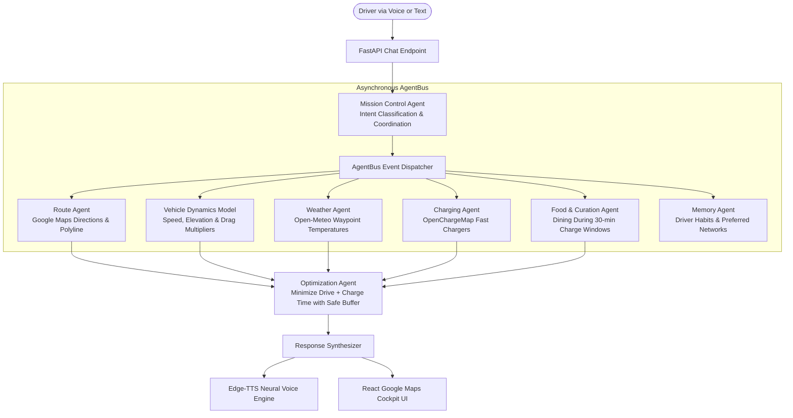

# 🚗 Electric Vehicle Brain (Car Co-Pilot)

> **Multi-agent AI co-pilot and long-distance road trip planner for Electric Vehicles.** Models battery physics, elevation, ambient weather, fast-charging curves, and lifestyle stops in real time.

<p align="center">
  
</p>

---

## Why EV Brain?

Standard navigation apps treat electric cars like internal combustion engines: they plot the shortest highway route, slap on a generic range estimate, and leave you to pray that a charging station works.

In reality, EV range is a physical and environmental equation:
1. **Speed & Aero Drag:** Cruising at 120 km/h consumes exponentially more energy than 80 km/h.
2. **Elevation & Terrain:** Climbing mountain ghats rapidly depletes the pack, while descending recharges via regenerative braking.
3. **Weather & HVAC:** Cold weather degrades lithium-ion chemistry; heavy air conditioning or heating adds continuous auxiliary load.
4. **Non-Linear Charging Curves:** DC fast chargers pump peak kilowatts between 10% and 80% State of Charge (SoC), then taper sharply. Arriving at a charger at 15% and leaving at 75% gets you to your destination hours faster than waiting around for 100%.

**Electric Vehicle Brain** solves this by coordinating specialized AI agents over an asynchronous event bus to compute realistic itineraries with optimal charging stops and curated meals during downtime.

---

## 🤖 Multi-Agent Architecture

Rather than relying on a single monolithic prompt, EV Brain divides responsibilities among specialized autonomous agents communicating through an in-memory `AgentBus`:



### The Specialized Agents
- **Mission Control Agent:** Intercepts driver voice inputs, classifies conversational intent, builds multi-step execution plans, and routes tasks.
- **Route Agent:** Calls Google Maps Directions API to extract route geometries, distances, and encoded polylines.
- **Vehicle Dynamics Model:** Computes energy consumption multipliers based on velocity profiles, elevation gradients, and HVAC load.
- **Charging Agent:** Queries OpenChargeMap and Google Places to locate high-power DC fast chargers (CCS2 / Type 2) along the travel corridor.
- **Weather Agent:** Pulls real-time ambient temperatures, wind vectors, and precipitation along waypoints to calculate aerodynamic resistance and thermal penalties.
- **Food & Curation Agent:** Recommends top-rated cafes, restaurants, and clean restrooms located at or within walking distance of the charging stop.
- **Optimization Agent:** Assembles the final itinerary, guaranteeing that battery State of Charge (SoC) never dips below safety thresholds (e.g., 10-15% reserve buffer).
- **TTS Engine:** Generates natural spoken responses via `edge-tts` streamed back to the car cockpit.

---

## 🛠️ Tech Stack

| Layer | Technology | Details |
| :--- | :--- | :--- |
| **Backend Framework** | [FastAPI](https://fastapi.tiangolo.com/) + Uvicorn | High-performance asynchronous API server |
| **Agent Framework** | [LangChain](https://www.langchain.com/) & [LangGraph](https://langchain-ai.github.io/langgraph/) | Agent routing, message graphs & state persistence |
| **LLM Engine** | Google Gemini / Ollama | Flexible language models for reasoning & intent classification |
| **Mapping & Routing** | Google Maps API (`googlemaps`) | Real turn-by-turn routes & polyline decoding |
| **Charging Database** | OpenChargeMap API | Global EV charging station data & connector types |
| **Weather Telemetry** | Open-Meteo API | Free, keyless meteorological forecasts along waypoints |
| **Voice & Speech** | `edge-tts` & `react-speech-recognition` | Low-latency neural speech synthesis & voice input |
| **Frontend Cockpit** | [React](https://react.dev/) + [Vite](https://vite.dev/) | Interactive dashboard with `@vis.gl/react-google-maps` |
| **Database** | SQLite + SQLAlchemy (`aiosqlite`) | Local trip storage, user preferences & vehicle specs |

---

## 📁 Repository Structure

```text
Car Co-pilot/
├── assets/                       # UI screenshot & media
│   └── preview.png
├── ev_travel_agent/
│   ├── agents/                   # Autonomous agent suite
│   │   ├── mission_control.py    # Master orchestrator & intent router
│   │   ├── route_agent.py        # Google Maps pathing & leg breakdown
│   │   ├── charging_agent.py     # OpenChargeMap station lookup
│   │   ├── weather_agent.py      # Waypoint weather & wind analysis
│   │   ├── food_agent.py         # Curated dining recommendations
│   │   ├── optimization_agent.py # Total travel time & charging curve solver
│   │   ├── vehicle_brain_agent.py# Battery capacity & SoC state tracker
│   │   └── memory_agent.py       # Driver preferences & trip history
│   ├── utils/
│   │   ├── agent_bus.py          # Asynchronous pub/sub event broker
│   │   ├── vehicle_dynamics.py   # Energy consumption physical model
│   │   └── route_utils.py        # Polyline decoding & geometric helpers
│   ├── services/
│   │   ├── maps_service.py       # Google Maps client wrapper
│   │   ├── charging_service.py   # Charger network query client
│   │   └── weather_service.py    # Open-Meteo weather client
│   ├── routers/
│   │   └── chat.py               # Conversational & SSE streaming endpoints
│   ├── frontend/                 # React + Vite cockpit application
│   │   ├── src/
│   │   │   ├── App.jsx           # Interactive map, itinerary card & voice input
│   │   │   └── App.css           # Dark glassmorphic cockpit styling
│   │   ├── package.json
│   │   └── vite.config.js
│   ├── database/                 # SQLite models & async sessions
│   ├── main.py                   # FastAPI server entry point
│   └── requirements.txt
├── requirements.txt
└── README.md
```

---

## 🚀 Getting Started

### 1. Prerequisites
- **Python 3.10+**
- **Node.js 18+**
- A **Google Maps API Key** (Directions & Places enabled)

### 2. Clone the Repository
```bash
git clone https://github.com/itsgoksz/electric-vehicle-brain.git
cd electric-vehicle-brain
```

### 3. Backend Setup
```bash
cd ev_travel_agent
python3 -m venv venv
source venv/bin/activate
pip install -r requirements.txt
```

Create a `.env` file inside `ev_travel_agent/`:
```env
GOOGLE_MAPS_API_KEY=your-google-maps-api-key
GEMINI_API_KEY=your-gemini-api-key
# Optional: OPENCHARGEMAP_API_KEY=your-openchargemap-key
```

Run the FastAPI backend server:
```bash
uvicorn main:app --reload --port 8000
```

### 4. Frontend Cockpit Setup
In a new terminal window:
```bash
cd ev_travel_agent/frontend
npm install
```

Create a `.env` in `ev_travel_agent/frontend/`:
```env
VITE_GOOGLE_MAPS_API_KEY=your-google-maps-api-key
```

Start the Vite development server:
```bash
npm run dev
```
Open [http://localhost:5173](http://localhost:5173) to plan road trips, test voice queries, and preview battery consumption curves.

---

<p align="center">
  Crafted by <a href="https://github.com/itsgoksz">itsgoksz</a>
</p>
